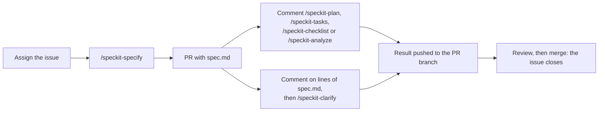
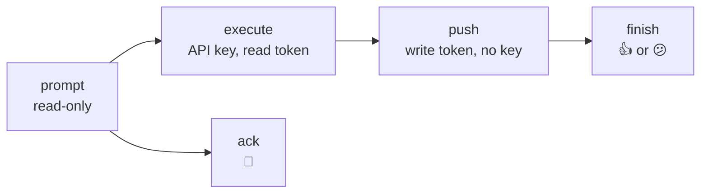

# spec-kit-github

Run [GitHub Spec Kit](https://github.com/github/spec-kit) from GitHub Actions. Assign an
issue and get a spec as a pull request. Comment a command on that PR to get the plan, the
tasks and more. You review everything in the PR, and an agent never approves its own work.



The files in the PR branch are the source of truth. Comments only point at them.

Status: `specify`, `plan`, `tasks`, `analyze`, `checklist` and `clarify` have run end to end.
`converge` is allowed but has not been run yet, because it only becomes useful after `implement`.
`implement` and `constitution` are not supported (see [Limitations](#limitations)).

## How it works

One workflow, [`spec-kit.yml`](.github/workflows/spec-kit.yml). Three jobs do the work, and two small
ones show its state:

| Job | Does | Holds |
|---|---|---|
| `prompt` | Decides whether an event should run a command, and builds the prompt | read-only token |
| `execute` | Runs the agent ([`claude-code-action`](https://github.com/anthropics/claude-code-action)) and writes a patch | `ANTHROPIC_API_KEY`, read-only token |
| `push` | Commits the patch (only `specs/**`) and opens the PR or comments | write token, no API key |
| `ack`, `finish` | React 👀 when a command starts, and 👍 or 😕 when it ends | write token, no API key |



The job with the API key never has a write token, and `push` takes only `specs/**` from what the
agent produced.

Triggers:

- `issues: assigned` to the login in `AGENT_ASSIGNEE` runs `/speckit-specify` with the issue
  title and body, and opens a PR from `spec/<issue>`. The PR body says `Closes #<issue>`, so the PR
  shows in the issue's Development sidebar, and merging it closes the issue. The PR is assigned to
  the same people as the issue.
- `issue_comment` on a `spec/*` PR runs the command in the comment and pushes the result to the
  PR branch.
- `pull_request_review_comment` on `specs/*/spec.md` runs `/speckit-clarify`, see below.

The command shows its state as a reaction on your comment, or on the issue for an assignment:
👀 running, 👍 done, 😕 failed. The final state replaces the 👀. A comment that gets no 👀 was not
handled: it was ignored, or it was skipped while another run was in progress. When a command
changes nothing, for example `/speckit-tasks` before there is a plan, the agent's own message is
posted as a comment so you can see why.

Every PR is also an issue on GitHub, so PR conversation comments arrive as `issue_comment`.

## Commands

| Where | Command | Result |
|---|---|---|
| Issue | assign to the agent login | `spec.md` and a PR (`/speckit-specify`) |
| PR comment | `/speckit-plan` | `plan.md`, `research.md`, `data-model.md`, `contracts/`, `quickstart.md` |
| PR comment | `/speckit-tasks` | `tasks.md` |
| PR comment | `/speckit-checklist` | `checklists/*.md` |
| PR comment | `/speckit-converge` | appends remaining work to `tasks.md` |
| PR comment | `/speckit-analyze` | consistency report, posted as one comment that later runs update |
| Comment on the `spec.md` file | `/speckit-clarify` | a reply in each of your open line threads, see below |

Text after the command is passed to the agent, for example `/speckit-plan use sqlite`.

**Clarify works on review threads on `spec.md`.** As you read the spec in the PR's Files tab, leave
plain comments on the lines you want clarified, with no command. Nothing runs for them. When you
are ready, open "Add comment on file" on `spec.md` and post `/speckit-clarify`, with any general
instructions for the run. One run then answers:

- your `/speckit-clarify` thread, and
- every other thread on that file that you started, that is still unresolved, and whose last
  comment is not the agent's.

The agent replies in each thread, one reply per thread. Where a comment settles something, it edits
the spec the way clarify normally does (a bullet in the Clarifications section, plus the sections it
affects) and commits, and the reply in your `/speckit-clarify` thread ends with the commit. Where a
comment is unclear, it asks one short question and changes nothing for that thread.

To continue: reply in a line thread, then post `/speckit-clarify` again, or reply in your
`/speckit-clarify` thread, which continues without the command. The agent never resolves a thread:
you resolve it when you are satisfied. Resolving is optional for the flow to work, but it takes the
thread out of later runs, and a reply from you in an unresolved thread brings it back. Threads started by other people, resolved threads, threads
the agent answered last and threads on other files are left alone, and only comments from people
with write access are read. A `/speckit-clarify` comment on a single line works too: that thread
is the command thread. Post with "Comment" to run it right away, or with "Start a review" and submit
the review when you are ready, so the line comments and the command arrive together.

**Two kinds of input.** A conversation comment on the PR runs a stage over the whole feature
(`/speckit-plan`, `/speckit-tasks`, ...). A comment on `spec.md` is feedback on that file
(`/speckit-clarify`). Both go through the same `execute` and `push` jobs.

**Analyze is read-only**, as the skill requires. It changes no files, so the agent's final message
is saved by the `execute` job and posted by `push` as a comment, which is edited in place on later runs.

## Set up

Use this repository as a template, then:

1. **Secret.** Add the repository secret `ANTHROPIC_API_KEY`. Use a dedicated key with a spend
   limit.
2. **Variable.** Add the repository variable `AGENT_ASSIGNEE` with the GitHub login whose
   assignment starts the flow. It must be a user you can assign issues to.
3. **Actions setting.** In Settings, Actions, General, allow "Allow GitHub Actions to create
   and approve pull requests".
4. **Free organization plan with a private repository.** Organization-level secrets and variables
   are not passed to the repository. Create them at repository level.

Spec Kit itself is already installed: `.specify/` and `.claude/skills/` are the output of
`specify init --here --integration claude`. To upgrade, re-run that command and commit the result.

## The development environment

`flake.nix`, `.devcontainer/` and `.envrc` follow the
[devcontainer-env example](https://github.com/devcontainer-env/devcontainer-env/tree/main/example)
and show how a project's toolchain and services reach both you and CI:

- `.devcontainer/` defines the services (here a Postgres database) and the environment variables
  they expose, such as `EXAMPLE_API_DATABASE_URL`.
- `flake.nix` is the dev shell. Its shell hook starts the containers and exports those variables
  into your shell, and `.envrc` (`use flake`) loads it with direnv.
- In CI the same bridge works: start the devcontainer with `devcontainer-env/devcontainer-ci`,
  install Nix, then run your commands with `nix develop --command ...`, and the exported variables
  are there. There is no separate CI job for this here, because it would run in every copy for
  nothing; the `execute` job below is the only place the workflow starts the devcontainer.

The `execute` job starts the devcontainer and installs Nix, but today's commands (specify, plan,
tasks, analyze, checklist, clarify) only read and write files, so the agent does not use that
environment yet. It is there for `/speckit-implement`, which needs the project's own toolchain and
services. Replace the example service and variables with your project's.

## Security model

- **Split jobs.** The job with the API key has no write access. The job with the write token
  never sees the API key.
- **Only `specs/**` is committed.** `git-commit` applies only allowed paths from the agent's
  patch and ignores everything else, so the agent cannot change the workflow, the actions or the
  settings.
- **Who can trigger a stage.** A comment runs only if the commenter is an owner, member or
  collaborator, the PR is from this repository, and the branch starts with `spec/`. Assignment
  runs only for the configured login.
- **Rules come from the default branch.** These events run the workflow file from the default
  branch. In `push`, the local actions are read from a default-branch checkout and the PR branch
  is only data.
- **Agent permissions** live in `.claude/settings.json`. On PRs from an author the action does not
  trust (our bot-authored ones), it restores `.claude/` from the base branch.
- **Issue text is untrusted input** and is sent to the model provider. Do not put secrets or
  personal data in issues.
- **Untrusted PR author guard.** Our PRs are authored by the bot, so `claude-code-action`
  denies shells, interpreters and package managers on them. That is fine for the commands above,
  which only read and write files. The workflow turns the guard off only for `/speckit-implement`.

## Layout

```
.github/workflows/spec-kit.yml     the flow
.github/workflows/actions.yml      typecheck, tests, build and a check that dist/ is current
.github/actions/                   TypeScript actions, one folder each (git-*, gh-*), shared code in core/
  gh-trigger/   decides what to run for an event
  git-diff/     writes the agent's changes under the allowed paths to a patch
  git-commit/   applies a patch (allowed paths only), commits and pushes
  gh-pull-request/   finds or creates the PR for a branch
  gh-comment/   creates a comment, or updates the one carrying a marker
  gh-reply/     replies in review threads, one reply per thread
  gh-react/     shows the state of a command as a reaction
.claude/  .specify/                Spec Kit and the agent's permissions
.devcontainer/  flake.nix  .envrc  the toolchain
```

## Development

```bash
cd .github/actions
npm ci
npm run typecheck
npm test        # includes tests against real temporary git repositories
npm run build   # bundles each action into <name>/dist/index.cjs
```

`dist/` is committed because the workflow runs it directly. CI fails if it is out of date.

## Limitations

- **`/speckit-implement`** needs an approval check, the flake environment for the agent and a
  wider path allowlist. Not built.
- **`/speckit-constitution`** writes outside `specs/` and is better done by hand once.
- Pull requests from forks are not supported.
- Runs for one PR are queued, one at a time. If you post several commands while a run is still
  going, a command in the middle can be skipped. Post it again.
- Review comment events (`/speckit-clarify`) use the workflow file from the PR branch, not from
  the default branch. After you change the workflow, merge the default branch into open spec PRs,
  or they keep running the old one.

## License

[MIT](LICENSE)
